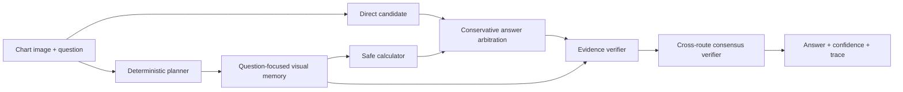

# Evidence-Grounded Multimodal Agent for Scientific Figure Reasoning

A reproducible research prototype that turns a compact local vision-language model into an
auditable scientific-figure reasoning agent. The system plans a question, extracts question-specific visual
evidence into structured memory, invokes a safe arithmetic tool when appropriate, and calibrates
the final answer with an evidence verifier.

The project bridges **multimodal foundation models**, **tool-using agents**, and **AI for Science**.
It evaluates both conventional chart reasoning on ChartQA and real scientific-paper figures from
SciVQA, including multi-panel plots, confusion matrices, architecture diagrams, and networks.

## Why this project

Direct vision-language prompting can be accurate while giving little indication of whether the
answer is grounded. Naive agents can be worse: an erroneous perception step may feed a calculator
and turn a small visual mistake into a confident numerical error. This implementation therefore
uses conservative tool arbitration and saves every intermediate decision for analysis.



## Main contributions

- Reproducible routing for lookup, count, comparison, arithmetic, and trend questions.
- Compact structured visual memory that avoids full-chart transcription.
- An allow-listed arithmetic evaluator that rejects code, names, calls, attributes, and indexing.
- Conservative tool arbitration: conflicting tool results are recorded but cannot automatically
  overwrite a plausible answer.
- Full JSONL traces for plans, evidence, tool calls, confidence, latency, and errors.
- Baselines and ablations: `direct`, `cot`, `full`, `no_memory`, `no_tools`, and `no_verifier`.
- Accuracy, relaxed numeric accuracy, tool success, verification coverage, latency, and expected
  calibration error (ECE).
- Exact match, Token-F1, and ROUGE-L for open scientific-figure answers.

## Results

### Real scientific-paper figures: SciVQA-100

One hundred distinct validation figures were sampled with one question per image and balanced
across binary, finite non-binary, and open-answer visual questions.

| Method | Accuracy | Token-F1 | ROUGE-L F1 | Mean latency |
|---|---:|---:|---:|---:|
| Direct VLM | 51.0% | 0.597 | 0.594 | 0.28 s |
| Chain-of-thought | 51.0% | 0.570 | 0.570 | 2.92 s |
| Full agent | **57.0%** | **0.643** | **0.640** | 4.81 s |

Removing structured memory returns accuracy to 51%. Removing arithmetic tools does not change
SciVQA accuracy, showing that this subset is limited by spatial and relational grounding rather
than arithmetic. A three-route consensus verifier covers 50% of samples at 72% selective accuracy.
See [`reports/scivqa_experiment.md`](reports/scivqa_experiment.md).

### Statistical charts: ChartQA-50

Fifty seeded, balanced samples from the ChartQA test split were evaluated with frozen
`Qwen/Qwen3-VL-2B-Instruct` on an 8 GB RTX 4060 Laptop GPU.

| Method | Accuracy | ECE ↓ | Mean latency | Verified rate |
|---|---:|---:|---:|---:|
| Direct VLM | 74.0% | 0.240 | 0.36 s | — |
| Chain-of-thought | 76.0% | 0.260 | 2.97 s | — |
| Full agent | **76.0%** | **0.087** | 4.67 s | 86.0% |

The full agent gains 2 percentage points over direct prompting and reduces ECE by 63.8%. These are
pilot results on 50 samples, not full-test-set claims. See
[`reports/pilot_experiment.md`](reports/pilot_experiment.md) for the protocol and failure analysis.

## Quick start

Python 3.10+ and a recent PyTorch installation are required. The reference run used Python 3.12,
PyTorch 2.12 with CUDA 12.6, Transformers 5.17, and torchvision 0.27.

```powershell
python -m venv .venv
.venv\Scripts\Activate.ps1
python -m pip install -e ".[dev]"

# Keep model and dataset caches off the system drive.
$env:HF_HOME = "D:\ResearchData\hf_cache"
$env:HF_HUB_CACHE = "D:\ResearchData\hf_cache\hub"

python scripts\run_benchmark.py --samples 50 --modes direct cot full
python scripts\run_scivqa_benchmark.py --samples 100 --modes direct cot full
python scripts\summarize_results.py reports\chartqa_full_n50.jsonl
```

The model is approximately 4.3 GB. Dataset files, extracted images, model weights, and generated
traces are intentionally excluded from Git.

## Repository structure

```text
configs/                         Experiment configuration
src/scimultimodal_agent/
  agent/                         Planner, memory, tools, verifier, orchestration
  data/                          ChartQA and SciVQA adapters and materialization
  evaluation/                    Metrics and trace runner
  models/                        Local Qwen3-VL inference adapter
scripts/                         Download, benchmark, and reporting entry points
tests/                           Unit and integration tests with a fake VLM backend
reports/pilot_experiment.md      Reproducible pilot results and error analysis
reports/scivqa_experiment.md     Scientific-figure results and component ablations
```

## Evaluation protocol

`scripts/run_benchmark.py` uses the same seeded sample list and loaded model for every mode. Decoding
is deterministic. ChartQA's relaxed numerical match uses a 5% tolerance. ECE is computed from the
agent confidence and relaxed correctness labels. All failures are preserved in traces rather than
silently retried.

Run code quality checks with:

```powershell
python -m pytest -q
python -m ruff check .
```

## Limitations and next steps

Arithmetic remains the principal ChartQA bottleneck, while fine-grained spatial grounding and
multi-option composition dominate SciVQA errors. The most useful next steps are:

1. region-level chart grounding before value extraction;
2. uncertainty-aware tool invocation and abstention;
3. evaluation on a larger SciVQA subset and SPIQA test-A;
4. a full ChartQA run with bootstrap confidence intervals;
5. comparison with OCR/table-reconstruction and stronger VLM baselines.

## References

- Ahmed Masry et al. [ChartQA: A Benchmark for Question Answering about Charts with Visual and
  Logical Reasoning](https://aclanthology.org/2022.findings-acl.177/), Findings of ACL 2022.
- Qwen Team. [Qwen3-VL-2B-Instruct model card](https://huggingface.co/Qwen/Qwen3-VL-2B-Instruct).
- Yao et al. [DoraemonGPT: Toward Understanding Dynamic Scenes with Large Language Models](https://arxiv.org/abs/2401.08392), 2024.
- Ekaterina Borisova et al. [SciVQA 2025: Overview of the First Scientific Visual Question
  Answering Shared Task](https://aclanthology.org/2025.sdp-1.18/), SDP 2025.

## License

MIT. ChartQA and Qwen3-VL remain subject to their respective licenses and terms.
